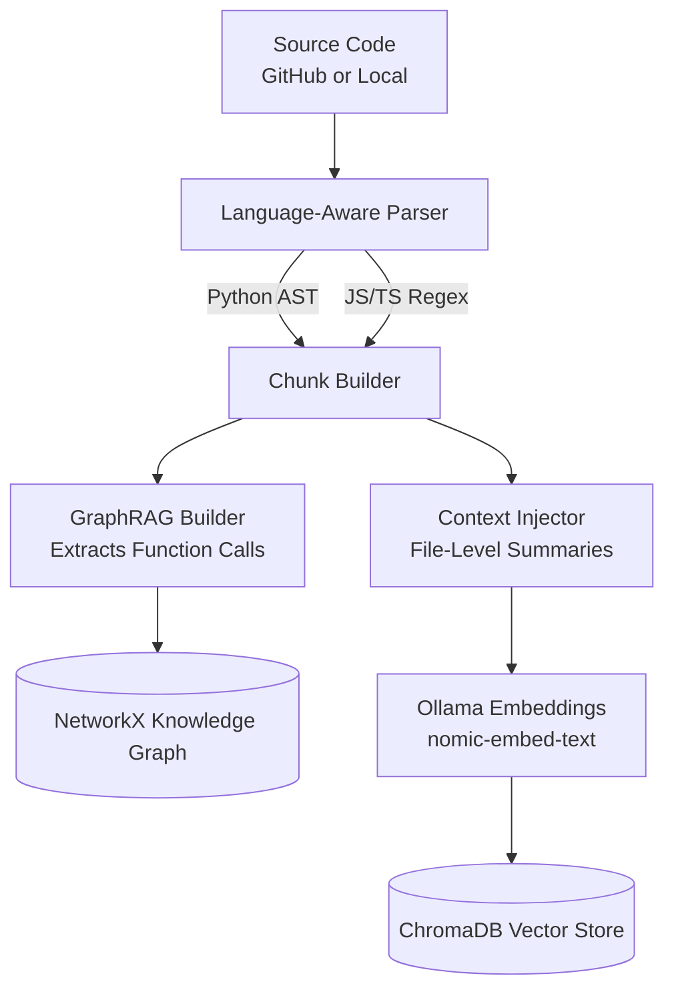
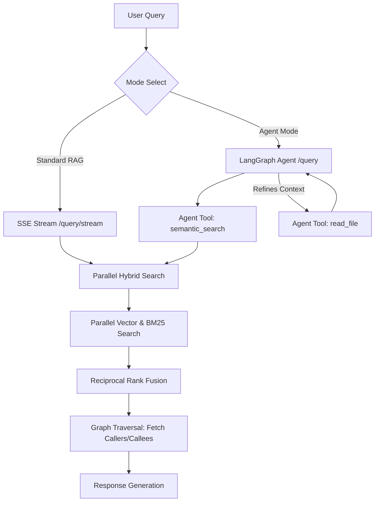

# CodeAtlas — Codebase Intelligence System

CodeAtlas is a 100% offline, Agentic GraphRAG system designed for developers and engineering teams. By supplying a GitHub repository URL, users can query their codebase in natural language. The system retrieves context, traverses functional dependencies, and generates precise answers complete with exact file paths and line numbers.

[](https://python.org)
[](https://react.dev)
[](https://vitejs.dev)
[](https://fastapi.tiangolo.com)
[](https://langchain.com)
[](LICENSE)

---

## Overview

Traditional Retrieval-Augmented Generation (RAG) systems fail on complex codebases due to arbitrary character-limit splitting and an inability to understand structural dependencies. CodeAtlas overcomes these limitations by combining:

1. **Abstract Syntax Tree (AST) Chunking**: Code is parsed logically into atomic structural units (functions, classes) rather than arbitrary text chunks.
2. **Knowledge Graphs (GraphRAG)**: Function-call dependencies are mapped at ingestion time. During retrieval, the engine dynamically injects caller and callee contexts, reducing missing-dependency hallucinations.
3. **Agentic Workflows**: Powered by LangGraph, the query engine can use tools to run semantic searches and read specific files when more context is required.
4. **Real-time SSE Streaming**: Server-Sent Events stream answers token-by-token to the React frontend.

CodeAtlas operates entirely locally. It uses Ollama to run open models (such as `qwen2.5-coder` or `qwen3`), so your code never leaves your machine.

---

## Core Capabilities

- **Redesigned Frontend**: A minimal, sidebar-free interface built with React, Vite and Tailwind CSS. Index a repo from a single input, switch repos from the top bar, and chat in a clean streaming view.
- **Dual Query Modes**:
  - **Standard RAG Mode (SSE Streaming)**: Connects to `/query/stream` for streamed replies with inline source tags.
  - **Agent Mode**: Uses LangGraph with `semantic_search` and `read_file` tools. Works best with larger models that support tool calling.
- **Parallelized Hybrid Search**: Runs dense vector retrieval (ChromaDB) and lexical keyword matching (BM25) in parallel, merged with Reciprocal Rank Fusion.
- **Fast Ingestion**: Uses `os.walk` directory pruning to skip `.git`, `node_modules`, `.venv` and similar folders in place.
- **Contextual Retrieval**: Generates file-level summaries and prepends them to individual chunks, preserving file-level context inside each chunk.
- **Cached Repository Overview**: Caches the repo summary (`summary_cache.json`) so later visits load instantly.
- **Precision Citations**: Answers include `filename:line_number` references and source chips.
- **Query Expansion Toggle**: Set `ENABLE_QUERY_EXPANSION=false` to skip LLM query expansion for faster local queries.

---

## System Architecture

### Phase 1: Ingestion Pipeline



1. **Source Resolution**: Accepts public GitHub URLs (cloned via GitPython) or local folders.
2. **Pruned Traversal**: `os.walk` ignores excluded directories before scanning, optimizing disk operations.
3. **Language-Aware Parsing**: Python uses `ast`; JavaScript/TypeScript uses regex patterns.
4. **Graph Construction**: Builds a NetworkX directed graph of function declarations and calls.
5. **Context Injection & Persistence**: File summaries are added to chunks, which are embedded and saved in ChromaDB alongside the call graph.

### Phase 2: Query Pipeline



1. **Streaming (Standard RAG)**: The query goes to `/query/stream`, which retrieves context, runs graph traversal, and streams tokens to the client.
2. **Agentic Inference**: The LangGraph workflow runs semantic searches and can read files through tool calls.
3. **Parallel Retrieval**: BM25 and ChromaDB lookups run on separate threads and are merged with RRF.
4. **Source Citations**: Sources are delivered with the answer and shown in the UI.

---

## Getting Started

### Prerequisites

- **Python 3.11** or higher
- **Node.js 18** or higher
- **Ollama** running locally
- **Git**
- **Docker Desktop** (optional, for the Docker setup)

### 1. Model Configuration

Pull the models via Ollama:

```bash
ollama pull qwen2.5-coder:3b
ollama pull nomic-embed-text
```

`qwen2.5-coder:3b` is a good fit for CPU-only machines. If you have a GPU or plenty of RAM, larger models such as `qwen2.5-coder:7b` give better answers.

### 2. Environment Setup

Copy the environment template:

```bash
cp .env.example .env
```

Review and adjust the variables:

```env
# Required: Ollama base URL and models
OLLAMA_BASE_URL=http://localhost:11434
OLLAMA_MODEL=qwen2.5-coder:3b
OLLAMA_EMBED_MODEL=nomic-embed-text

# Optional: skip LLM query expansion for faster local queries
ENABLE_QUERY_EXPANSION=false

# Optional: Chroma persist directory
CHROMA_PERSIST_DIR=./chroma_db
```

---

## Running the Application

### Option A: Running Locally

#### 1. Backend (FastAPI)

```bash
cd backend
python -m venv .venv

# Linux/macOS
source .venv/bin/activate
# Windows
.venv\Scripts\activate

pip install -r requirements.txt
python main.py
```

The API runs on port `8000`.

#### 2. Frontend (React + Vite)

In a new terminal:

```bash
cd frontend
npm install
npm run dev
```

Open **http://localhost:5173** in your browser.

---

### Option B: Running via Docker Compose

1. **Set environment variables** in `.env` so the backend container can reach Ollama on your host:
   * **Windows/macOS:**
```env
     OLLAMA_BASE_URL=http://host.docker.internal:11434
     CHROMA_PERSIST_DIR=/app/chroma_db
```
   * **Linux:** use your Docker bridge IP (typically `http://172.17.0.1:11434`).

   Ollama must accept connections from containers, so set the environment variable `OLLAMA_HOST=0.0.0.0` and restart Ollama.

2. **Start the containers:**
```bash
   docker compose up -d --build
```

3. **Access the services:**
   - **App**: `http://localhost:5173`
   - **API docs**: `http://localhost:8001/docs`
   - **Health check**: `http://localhost:8001/health`

   The backend container is mapped to port `8001` on the host.

> **Note:** Containers cannot see folders on your computer. In Docker, index GitHub URLs, or mount a local folder into the backend container through `docker-compose.yml`.

---

## Usage

1. Paste a GitHub repository URL on the home screen and click **Index**.
2. Wait for indexing to finish. On CPU-only machines this can take a few minutes.
3. Open the repo, read the overview, and ask questions in plain English.
4. Switch between repos with the selector in the top bar.

---

## Troubleshooting

- **"Failed to connect to Ollama"**: make sure Ollama is running (`http://localhost:11434` should say "Ollama is running"). With Docker, Ollama must listen on `0.0.0.0` and `OLLAMA_BASE_URL` must use `host.docker.internal`.
- **Answers are very slow**: this usually means the model runs on CPU. Use a smaller, non-reasoning model such as `qwen2.5-coder:3b`, ask specific questions, and let the first overview finish generating (it is cached afterwards).
- **Agent mode returns odd output**: small models are unreliable at tool calling. Use Standard mode, or a larger model that supports tools.

---

## Project Structure

```text
codeatlas/
├── backend/
│   ├── main.py                     # FastAPI application entry point
│   ├── reposage/                   # Core Python package
│   │   ├── chunkers/
│   │   │   ├── python_chunker.py   # AST parser and call graph extraction
│   │   │   ├── js_chunker.py       # Regex JS/TS parser
│   │   │   └── generic_chunker.py  # Line-based fallback
│   │   ├── ingestion/
│   │   │   ├── repo_indexer.py     # Repo traversal and ChromaDB indexer
│   │   │   ├── file_watcher.py     # Watchdog directory sync
│   │   │   └── docstring_gen.py    # Chunk context summary generator
│   │   ├── query/
│   │   │   ├── agent_engine.py     # LangGraph agent workflow
│   │   │   ├── rag_engine.py       # Hybrid search and call graph traversal
│   │   │   └── query_transformer.py # Query expansion and bypass toggle
│   │   └── analysis/
│   │       └── repo_summarizer.py  # Cached repository overview generator
│   └── requirements.txt
├── frontend/
│   ├── src/
│   │   ├── components/
│   │   │   └── ChatInterface.jsx   # Streaming chat view, overview and citations
│   │   ├── utils/
│   │   │   └── markdown.js         # Lightweight markdown renderer
│   │   ├── App.jsx                 # App shell, home screen and repo switcher
│   │   ├── index.css               # Theme and styling
│   │   └── main.jsx                # React entry point
│   ├── package.json
│   ├── vite.config.js
│   └── Dockerfile
├── docker-compose.yml
├── .env.example
└── README.md
```

---

## Testing

Run the backend test suite:

```bash
python -m pytest backend/tests/ -v
```
